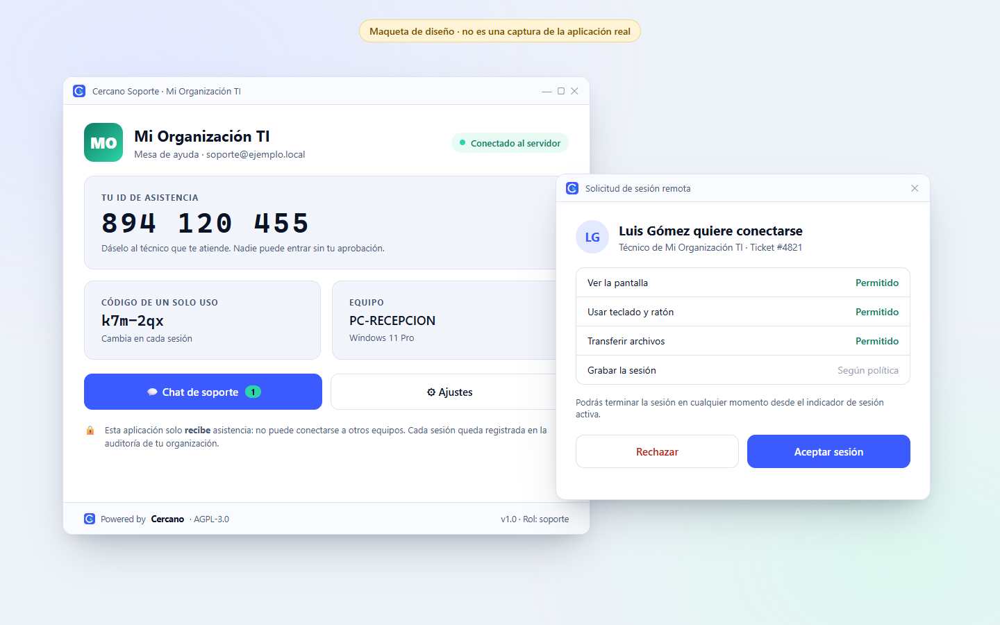
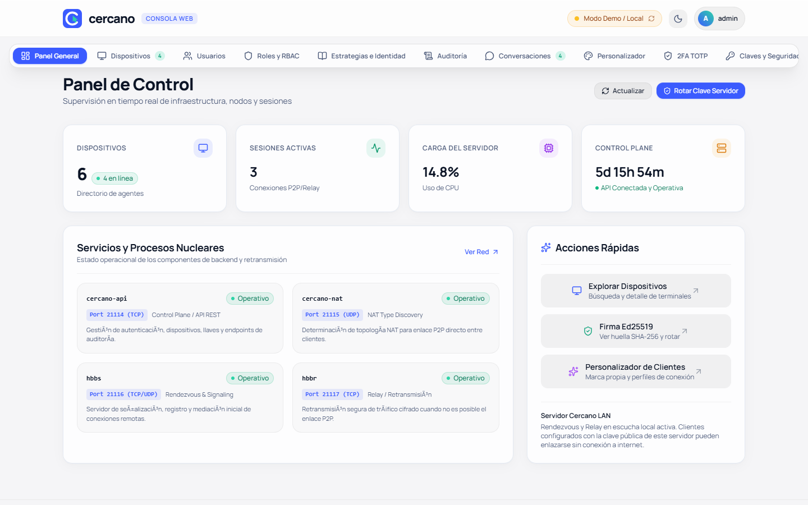
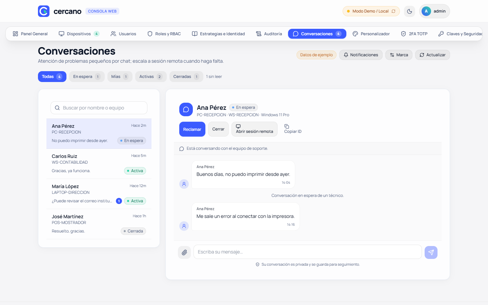
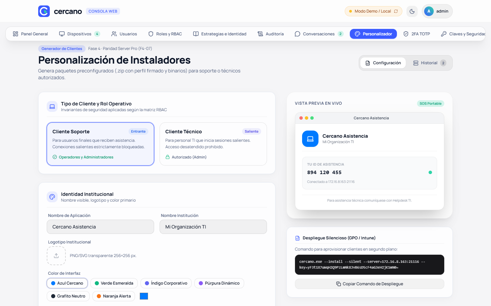
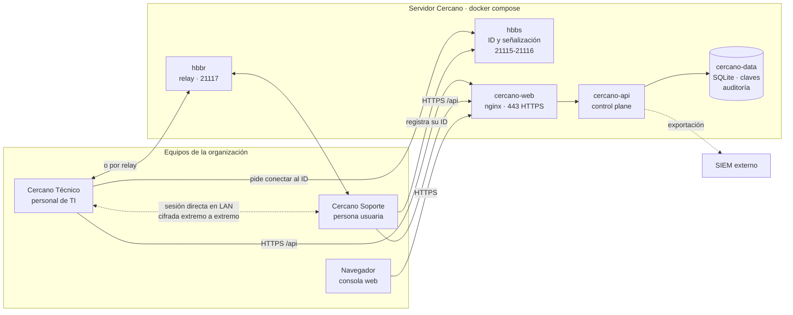

<p align="center">
  
</p>

<p align="center"><em>Soporte remoto, como si estuvieras ahí.</em></p>

<p align="center">
  
  
  
  <a href="https://github.com/AlcsPower/cercano/actions/workflows/ci.yml"></a>
</p>

---

# Cercano

**Cercano** es una plataforma integral de soporte y asistencia remota para equipos de TI e instituciones: **auditable**, **segura por defecto**, **optimizada para redes corporativas/LAN** y concebida con **código 100% abierto**.

Ofrece las capacidades empresariales que tradicionalmente se reservan a versiones de pago en herramientas propietarias (como RustDesk Server Pro), centrándose en cuatro pilares:
1. **Auditoría inmutable con integridad demostrable**: Cada sesión, comando, transferencia de archivos y evento administrativo se firma y sella en una cadena criptográfica de hashes con checkpoints Ed25519 verificables sin conexión al servidor.
2. **Trazabilidad de extremo a extremo (`trace_id`)**: Correlación temporal y operativa precisa entre el cliente, el servidor de señalización/relay y la consola de gestión.
3. **Generador y empaquetador de instaladores personalizados (Hito M2)**: Compilación reproducible de instaladores Windows (`.exe` y `.msi`) configurados por rol (`soporte` vs `tecnico`), con firma digital Authenticode enchufable, listas de materiales de software (SBOM CycloneDX/SPDX) y verificación de procedencia.
4. **Seguridad y roles aplicados en el servidor (ADR-008)**: El servidor valida de forma inmutable el tipo de instalador (`installer_id`), bloqueando cualquier intento de inicio de conexiones o escalada no autorizada desde clientes de soporte y disparando alarmas de seguridad críticas.

> 🚀 **Estado del proyecto (2026-11-25).** Fases F0, F1, F4 (consola, RBAC y 2FA), F4.5 (Cercano Chat) y F5 (identidad y control de acceso) cerradas. F2 tiene tareas en verificación. F3 tiene el hito M2 reabierto: el generador, los perfiles, la firma y los roles funcionan, pero **el cliente Windows real aún no se compila de forma fiable** (F3-19…22, bloqueo B-002). F6, F7 y F8 están pendientes.  
> Detalle en [`docs/status/TAREAS.md`](docs/status/TAREAS.md), los informes de cierre en [`docs/status/`](docs/status/) y el [`docs/ROADMAP.md`](docs/ROADMAP.md). La rama principal es `main`.

---

## Así se ve

**Aplicación de escritorio Cercano Soporte** (maqueta de diseño: el cliente Windows real todavía no se compila, F3-19). La persona usuaria ve su ID, chatea con soporte y aprueba cada sesión remota.

<p align="center"></p>

**Consola web de administración** (capturas reales en modo demo, con datos de ejemplo):

| Panel general | Cercano Chat |
|---|---|
|  |  |

| Personalizador de instaladores |
|---|
|  |

Para ver la consola en local sin servidor: `VITE_DEMO_MODE=true npm run dev` dentro de `console-web/`.

---

## Cómo funciona en producción

Una organización instala **un servidor Cercano** (en sus instalaciones o en la nube) y reparte **dos aplicaciones de escritorio**: una para los equipos que reciben soporte y otra para el personal técnico. Todo se administra desde la **consola web**.



**Una sesión de soporte, paso a paso**

1. **Preparar.** Desde la consola, un administrador genera los instaladores `soporte` y `tecnico` con un perfil firmado (servidor, clave, política y marca de la organización) y los reparte, por ejemplo por GPO o Intune ([guía](docs/guias/despliegue-masivo.md)).
2. **Registrar.** Al instalarse, cada equipo obtiene un ID en `hbbs` y envía su latido a `cercano-api`, así que aparece en la consola. `cercano-api` comprueba el `installer_id` y la revocación.
3. **Pedir ayuda.** La persona usuaria escribe por **Cercano Chat** desde su aplicación; un técnico la atiende en la consola y, si hace falta, escala a sesión remota.
4. **Conectar.** El técnico, con sesión iniciada en `cercano-api`, conecta al ID. `hbbs` coordina el encuentro: en la LAN la conexión es directa y, si no es posible, pasa por `hbbr`. En ambos casos va cifrada de extremo a extremo. El servidor rechaza que una aplicación `soporte` inicie sesiones (ADR-008).
5. **Consentir y trabajar.** La persona usuaria aprueba la sesión y puede cortarla en cualquier momento. Si el técnico necesita permisos de administrador, pide una elevación que también requiere el consentimiento de la persona usuaria.
6. **Auditar.** Conexión, archivos, elevación, chat y acciones de consola quedan como eventos encadenados con hash y checkpoints firmados, con alarmas en tiempo real. Se verifican fuera de línea con `cercano-audit` y se pueden exportar a un SIEM.

**Puertos que hay que abrir en el servidor**

| Puerto | Protocolo | Servicio | Uso |
|---|---|---|---|
| 443 (y 80 → redirige) | TCP | `cercano-web` | Consola web y API para las aplicaciones (HTTPS) |
| 21115 | TCP | `hbbs` | Prueba de tipo de NAT |
| 21116 | TCP y UDP | `hbbs` | Registro de ID, latido y señalización |
| 21117 | TCP | `hbbr` | Relay de sesiones |
| 21118 / 21119 | TCP | `hbbs` / `hbbr` | WebSocket (opcional) |
| 21114 | TCP | `cercano-api` | Solo `127.0.0.1` y red interna; no se publica |

Instalación del servidor paso a paso en [`deploy/README.md`](deploy/README.md).

> **Propuesta en revisión (ADR-015, F3.5).** Hoy cada instalador lleva el servidor de su organización dentro del perfil firmado. El [ADR-015](https://github.com/AlcsPower/cercano/pull/2) propone una **aplicación genérica**, descargable y usable con cualquier servidor (modo libre), y un **agente Cercano** por organización que la vincula con una configuración firmada. Cuando se apruebe, este diagrama se actualizará.

---

## Componentes y Arquitectura

El monorepo está organizado en módulos desacoplados y libres de dependencias propietarias:

```
cercano/
├── builder/
│   └── cercano-build/    # CLI y generador de paquetes Windows (.exe/.msi), Authenticode, SBOM y procedencia
├── client/               # Script de build del cliente base y utilidades propias del cliente
├── control-plane/
│   ├── audit-core/       # Crate Rust: Cadena criptográfica SHA-256 (RFC 8785) con DB SQLite append-only
│   ├── cercano-api/      # API REST: auth, 2FA, RBAC, dispositivos, chat, políticas, builds, revocación y alarmas
│   └── cercano-audit/    # Herramienta CLI: Exportación y verificación forense fuera de línea
├── console-web/          # Consola Web administrativa: React 18 + Vite + Tailwind CSS
├── deploy/               # docker compose, Dockerfiles, nginx y unidades systemd del servidor
├── vendor/               # Código base del cliente y servidor gestionado bajo parches limpios e idempotentes
├── patches/              # Parches sobre vendor/ (001 a 012), registrados en patches/INDEX.md
├── branding/             # Guía de marca, logotipos oficiales (SVG/PNG) e iconos de instalador (.ico)
├── docs/                 # Roadmap, arquitectura, planes, ADR, especificaciones, guías y estado
├── tests/                # Pruebas e2e y laboratorio LAN
└── tools/                # Utilidades de desarrollo, scripts de parches y verificación de licencias AGPL-3.0
```

---

## Capacidades Implementadas

| Capacidad | Descripción | Componente | Estado |
|---|---|---|---|
| **Cadena Criptográfica de Auditoría** | Registro append-only con serialización canónica RFC 8785, ligada a un bloque génesis mediante SHA-256 y protegida contra escritura/borrado en SQLite. | `audit-core` | ✅ Producción |
| **Checkpoints Firmados & Verificador CLI** | Creación periódica de checkpoints firmados con Ed25519 y CLI `cercano-audit` para verificación independiente de integridad en archivos JSONL. | `cercano-audit` | ✅ Producción |
| **Correlación de Traza (`trace_id`)** | Agregación de eventos y métricas de sesión (duración exacta, bytes transferidos, archivos) a través de `GET /api/audit/traces/:trace_id`. | `cercano-api` | ✅ Producción |
| **Motor de Alarmas en Tiempo Real** | Detección automática en ventana deslizante para fuerza bruta, ráfagas de IP, violaciones de lista blanca CIDR y violación de roles. | `cercano-api` | ✅ Producción |
| **Consola Web Administrativa** | UI moderna, accesible, con fuentes auto-hospedadas (100% offline), tema claro/oscuro de alto contraste y previsualizador interactivo. | `console-web` | ✅ Producción |
| **Generador CLI `cercano-build`** | Compilación y empaquetado reproducible (Estrategia A) a partir de perfiles JSON validados bajo JSON Schema y firmados con Ed25519. | `cercano-build` | ✅ Producción |
| **Empaquetado Windows (.exe y .msi)** | Generación de instaladores `.exe` auto-extraíbles y paquetes `.msi` (WiX v4/CFBF) con UpgradeCodes estables y desinstalación limpia. **Requiere el binario base del cliente Windows, que aún no se compila (F3-19).** | `cercano-build` | ⚠️ Solo estructura; sin cliente real |
| **Firma Authenticode Enchufable** | Firma digital con soporte para drivers `signtool`, `osslsigncode` y `mock`, con sello de tiempo RFC 3161 obligatorio y aborto atómico. | `cercano-build` | ✅ Producción |
| **Servicio de Compilación en API** | Endpoints `POST /api/builds`, cola asíncrona, control de concurrencia semafórico, almacenamiento y retención con RBAC estricto. | `cercano-api` | ✅ Producción |
| **Auditoría Encadenada `build.*`** | Trazabilidad completa de generación de instaladores: `build.requested`, `build.started`, `build.completed`, `build.downloaded`, `build.revoked`. | `cercano-api` | ✅ Producción |
| **Revocación y Caducidad Inmediata** | Publicación de listas de revocación con caché HTTP y ETag; rechazo fulminante de dispositivos revogados o caducados (< 60 s). | `cercano-api` | ✅ Producción |
| **SBOM y Atestación de Procedencia** | Generación de SBOMs estándar CycloneDX (v1.5) y SPDX (v2.3) con hash reproducible exacto en `SHA256SUMS` y `build-provenance.json`. | `cercano-build` | ✅ Producción |
| **Enforcement de Roles en Servidor** | Mitigación autoritativa (ADR-008): el servidor bloquea el inicio de conexiones desde instaladores `soporte` y dispara `alarm.role_violation`. | `cercano-api` | ✅ Producción |
| **Elevación con Credenciales Efímeras** | Flujo Spike S6 con consentimiento de usuario (60s), borrado en RAM (`zeroize`), bloqueo tras 3 intentos (`elev.exhausted`) y Zero Secrets. | `cercano-api` + cliente | ✅ Producción |
| **Auditoría `elev.*` y Alarmas** | Esquema extendido RFC con eventos de elevación encadenados y 5 alarmas en tiempo real (`alarm.role_violation`, `elev_exhausted`, etc.). | `audit-core` + `cercano-api` | ✅ Producción |
| **Modelo de Amenazas y Fuzzing** | Análisis STRIDE/LINDDUN formalizado (`threat-model-roles-elevation.md`), pruebas de abuso y fuzzing con 0 hallazgos altos/críticos. | Documentación + tests | ✅ Producción |
| **Guía de Despliegue Masivo** | Documentación exhaustiva para despliegues empresariales mediante GPO, Microsoft Intune, RMM, exclusiones EDR y scripts de validación. | `docs/guias/` | ✅ Producción |

---

## Requisitos Previos

- **Rust**: 1.75 o superior (con `cargo`)
- **Node.js**: v18.0 o superior (con `npm` 9+)
- **SQLite3**: Incluido o disponible en el sistema
- **Linux / WSL / macOS / Windows**

---

## Inicio Rápido (Desarrollo Local)

### 1. Clonar el repositorio
```bash
git clone https://github.com/AlcsPower/cercano.git
cd cercano
```

### 2. Ejecutar la suite de pruebas del backend (Rust)
Todas las pruebas del core criptográfico, API, generador y CLI pueden ejecutarse con:
```bash
cargo test --workspace
```
*(Pruebas unitarias y de integración del núcleo criptográfico, la API, el generador y el CLI; el CI las ejecuta en cada PR).*

### 3. Ejecutar la Consola Web
```bash
cd console-web
npm install
npm run dev
```
La consola estará disponible en `http://localhost:3000`.

### 4. Generar un instalador con `cercano-build`
```bash
# Compilar el CLI generador
cargo build --release -p cercano-build

# Generar instalador para rol soporte con SBOM y firma
./target/release/cercano-build \
  --profile perfiles/soporte.json \
  --out dist/ \
  --package-windows \
  --sbom
```

### 5. Verificar una traza de auditoría con el CLI
```bash
# Exportar base de datos a formato JSONL canónico
cargo run -p cercano-audit -- export-db /ruta/a/audit.db eventos.jsonl

# Verificar la validez de la cadena de hashes y las firmas Ed25519
cargo run -p cercano-audit -- verify eventos.jsonl --pubkey <CLAVE_PUBLICA_HEX>
```

---

## Especificaciones y Gobernanza

- **ADR-008 — Roles de Instalador:** Decisión arquitectónica rectora: *«El rol se aplica en el servidor, no solo en el instalador»* ([`docs/adr/008-roles-instalador.md`](docs/adr/008-roles-instalador.md)).
- **Guía de Despliegue Masivo:** Guía técnica para GPO, Microsoft Intune, herramientas RMM y parámetros silenciosos ([`docs/guias/despliegue-masivo.md`](docs/guias/despliegue-masivo.md)).
- **Guía de Empaquetado Windows:** Especificación de instaladores `.exe` y paquetes `.msi` ([`docs/guias/empaquetado-windows.md`](docs/guias/empaquetado-windows.md)).
- **Cercano Chat (F4.5):** Chat de soporte embebido en el cliente y gestionado desde la consola; contrato en [`docs/specs/chat.md`](docs/specs/chat.md), plan en [`docs/PLAN-F4.5-CHAT.md`](docs/PLAN-F4.5-CHAT.md) y decisión en [`docs/adr/010-cercano-chat.md`](docs/adr/010-cercano-chat.md).
- **Esquema de Eventos de Auditoría**: Especificado formalmente bajo JSON Schema Draft-07 en [`docs/specs/audit-events.schema.json`](docs/specs/audit-events.schema.json) y detallado en [`docs/specs/audit-events.md`](docs/specs/audit-events.md).
- **Reglas de Trabajo para Agentes y Colaboradores**: Consulta [`AGENTS.md`](AGENTS.md).
- **Seguridad y Clean-Room**: Prohibición estricta de ingeniería inversa o descompilación de binarios comerciales. Cercano se construye bajo el principio *clean-room* a partir de documentación pública y estándares abiertos. Consulta [`docs/ARQUITECTURA.md`](docs/ARQUITECTURA.md).

---

## Licencia

Cercano se distribuye bajo los términos de la **GNU Affero General Public License v3.0 (AGPL-3.0)**. Consulta el archivo [`LICENSE`](LICENSE) para ver los términos completos.

La atribución a los proyectos originales de los que deriva se encuentra registrada en el archivo [`NOTICE`](NOTICE).  
*Cercano es un proyecto comunitario independiente y no está afiliado ni respaldado por RustDesk.*
