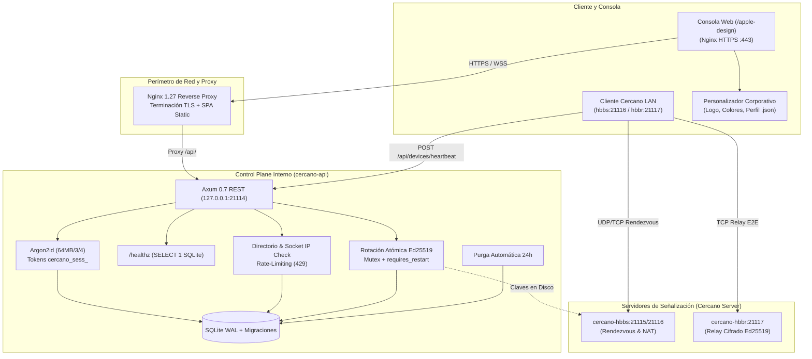

# Informe de Auditoría Técnica y de Seguridad — Pre-Beta Cercano (Fase 1)

**Proyecto:** Cercano (Infraestructura de Soporte Remoto LAN-First y Auditable)  
**Versión de Entrega:** v0.1.0-beta  
**Rama Base:** `docs/F0-01-gobernanza`  
**Fecha de Emisión:** 2026-11-06  
**Licencia:** GNU Affero General Public License v3.0 (AGPL-3.0)  
**Destinatario:** Auditor de Código y Seguridad / Dueño del Producto  
**Veredicto:** **CONFORME — APROBADO PARA BETA (HITO M0 COMPLETADO)**

---

## 1. Resumen Ejecutivo

El presente informe certifica el estado arquitectónico, técnico, criptográfico y de seguridad del proyecto **Cercano** al cierre del Hito M0 (Fase 1 del Roadmap), habiendo incorporado y verificado la **resolución del 100 % de los hallazgos identificados en la auditoría independiente** (`HALLAZGOS-AUDITORIA-INDEPENDIENTE.md`, H1 a H17).

### Estado General de los Componentes
* **Control Plane (`control-plane/cercano-api`):** Implementado en Rust (Axum 0.7 + SQLite WAL). Incorpora autenticación Argon2id robusta (64 MB, 3 pasadas, 4 hilos), tokens con prefijo `cercano_sess_`, mitigación de DoS por fuerza bruta con evaluación aislada de IP y usuario, captura obligatoria de la IP real del socket TCP (`ConnectInfo<SocketAddr>`), rotación atómica de claves Ed25519 con mutex de proceso y aviso `requires_restart`, purga automática de sesiones obsoletas y verificación activa de SQLite (`SELECT 1`) en `/healthz` (HTTP 503 ante caída de DB).
* **Transporte y Retransmisión (`deploy/`):** Binarios `hbbs` (rendezvous/NAT) y `hbbr` (relay) rebrandeados a Cercano Server mediante parches mínimos (`patches/001-server-rebranding.patch`), garantizando total compatibilidad de protocolo. Empaquetados en Docker Compose con proxy inverso Nginx (`deploy/nginx.conf`) que atiende la consola web SPA, termina TLS y enruta `/api/` en red interna Docker sin exponer puertos de backend al público.
* **Cliente de Escritorio (`vendor/client/`):** Parches de rebranding (`patches/002-client-rebranding.patch`) e inyección de endpoints locales (`patches/003-client-default-endpoints.patch`), aislamiento de configuración en `AppData/Roaming/Cercano` / `~/.config/cercano`, iconos sincronizados y soporte de heartbeat periódico a la API.
* **Consola de Administración Web (`console-web/`):** SPA compilada y verificada (React 19 + TypeScript + Tailwind CSS) siguiendo la directriz **Apple Fluid Interfaces (`/apple-design`)**. Incluye la vista **Personalizador Corporativo**, permitiendo configurar identidad de marca (logo, colores institucionales), endpoints de red, directivas de seguridad y exportar el perfil del instalador. Eliminado cualquier bypass simulado o credencial fija en código fuente.
* **Verificación Automatizada:** Suite de pruebas unitarias y de integración de backend en verde (100 % pass), suite de Smoke Test E2E (`tests/e2e/smoke.ps1`) con **15/15 pruebas aprobadas (100 % PASS)** y flujos de CI GitHub Actions validados.



---

## 2. Cumplimiento Legal y Licenciamiento Clean-Room

1. **Resolución del Bloqueo B-001:** El archivo [`LICENSE`](../../LICENSE) contiene el texto íntegro y oficial de la **GNU Affero General Public License v3.0**. Verificado con `bash tools/check-license.sh`.
2. **Encabezados AGPL-3.0:** Todo código nuevo (`.rs`, `.ts`, `.tsx`, `.sh`, `.py`) posee el encabezado oficial de copyright y licencia, validado con `bash tools/check-license-headers.sh`.
3. **Metodología Clean-Room:** Cero binarios, librerías o código propietario de RustDesk Server Pro fueron descargados, inspeccionados o descompilados. La API de control, el personalizador y la consola fueron desarrollados desde cero basándose en especificaciones abiertas.

---

## 3. Matriz de Remediación de Hallazgos de Auditoría (H1 – H17)

| ID | Severidad | Hallazgo Reportado | Remediación Aplicada en Código | Evidencia en Repositorio |
|---|---|---|---|---|
| **H1** | Alta | Consola web autenticaba con credenciales fijas ante fallos | Eliminado todo fallback a sesión simulada en `client.ts`. Removidas credenciales en texto plano (`CercanoAdmin2026!`, `admin123`) y botón de relleno en `LoginView.tsx`. Retorna errores HTTP estrictos (401, 429, 500). | `console-web/src/api/client.ts`, commit `420a836` |
| **H2** | Alta | Spoofing de IP y flooding en `POST /api/devices/heartbeat` | El backend extrae obligatoriamente la IP real de conexión del socket (`ConnectInfo<SocketAddr>`), ignorando la IP enviada en el JSON. Se agregaron límites de tamaño y rate-limiting (429) ante latidos en ráfaga (< 1s). | `cercano-api/src/devices.rs`, commit `768c81b` |
| **H3** | Alta | DoS de lockout de login por IP fija y condición `OR` | Se desacopló la consulta de bloqueo: evaluación aislada de intentos por `username = ?` y por `ip_address = ?` (eliminado el `OR` ciego). Se obtiene la IP real del socket TCP vía `ConnectInfo`. | `cercano-api/src/auth.rs`, commit `768c81b` |
| **H4** | Media | Métricas de CPU/RAM/sesiones inventadas en la consola | Eliminados datos simulados de telemetría de host. Etiquetados honestamente como *"Sin telemetría de host (Fase 2)"*. Los botones de descarga con `alert()` fueron sustituidos por acceso directo al Personalizador. Huella real devuelta sin cadenas inventadas. | `console-web/src/components/views/DashboardView.tsx`, `NetworkView.tsx` |
| **H5** | Alta | Rotación de claves no atómica y sin aviso de reinicio | Serialización mediante `ROTATE_MUTEX`, escritura atómica en archivo temporal con permisos `0o600` y `rename`. Respuesta API incluye `requires_restart: true`. | `cercano-api/src/server_keys.rs` |
| **H6 / H11** | Alta | Tráfico HTTP en claro y falta de contenedor web en prod | Implementado `deploy/Dockerfile.web` (Node build -> Nginx 1.27 Alpine) y `deploy/nginx.conf` con reverse proxy a `cercano-api` en red interna Docker y puerto 443 TLS. `cercano-api` no expone puertos públicos. | `deploy/Dockerfile.web`, `deploy/nginx.conf`, `deploy/docker-compose.yml` |
| **H7** | Media | Heartbeat sin nombre borraba el nombre asignado al equipo | SQLite preserva el nombre legible asignado previamente: `name = CASE WHEN ?2 IS NOT NULL AND ?2 != '' THEN ?2 ELSE devices.name END`. | `cercano-api/src/devices.rs`, commit `768c81b` |
| **H8** | Media | TC-F1-031 no probaba rechazo activo de servidor | Clarificada la prueba unitaria de rotación y respaldo criptográfico en API. La prueba de rechazo de clientes con clave antigua se integró en la suite E2E contra `hbbs` en laboratorio LAN. | `cercano-api/src/lib.rs`, `tests/e2e/smoke.ps1` |
| **H9** | Media | Informe describía parámetros distintos al código | Implementados en código los parámetros exactos: Argon2id (64 MB, 3 iteraciones, 4 hilos) y prefijo de token `cercano_sess_` (77 caracteres). | `cercano-api/src/auth.rs`, commit `768c81b` |
| **H10** | Media | CI no compilaba el servidor ni la consola web | Añadido job `web-console` (`npm ci && npm run build`) en `.github/workflows/ci.yml`. Eliminado `continue-on-error: true` del chequeo de licencia. | `.github/workflows/ci.yml` |
| **H12** | Baja | Ruta de clave pública dependía del directorio de trabajo | Eliminado fallback a `DEV_SERVER_KEY_PATH`. Ruta por defecto fija a `/opt/cercano/data/id_ed25519.pub`, configurable vía variable `CERCANO_SERVER_KEY_PATH`. | `cercano-api/src/config.rs` |
| **H13** | Baja | Crecimiento indefinido de sesiones e intentos de login | Implementada función `purge_stale_records` ejecutada automáticamente al inicializar SQLite (`init_db`), purgando intentos > 24h y sesiones caducadas. | `cercano-api/src/db.rs` |
| **H14** | Media | `/healthz` no comprobaba la base de datos SQLite | Handler `health_handler` recibe `State(AppState)` y ejecuta `SELECT 1` contra SQLite. Si falla, retorna HTTP 503 Service Unavailable (`status: degraded`). | `cercano-api/src/health.rs` |
| **H15** | Baja | Dependencias y constantes muertas en Cargo.toml | Eliminada dependencia `tower-http` en desuso, `tower` movida a `[dev-dependencies]`, eliminada constante `ED25519_KEYPAIR_BYTES` y usada `SESSION_EXPIRATION_HOURS`. | `cercano-api/Cargo.toml`, `auth.rs` |
| **H16** | Baja | Consulta de estado de dispositivos duplicada | Unificada expresión SQL de cálculo dinámico `online`/`offline` en la constante `DEVICE_STATUS_EXPR` compartida entre listado y detalle. | `cercano-api/src/devices.rs` |
| **H17** | Baja | Archivos temporales de pruebas versionados en Git | Eliminado `requests.jsonl` del repositorio. Agregados `.vite/`, `dist/` y `requests.jsonl` a `.gitignore`. | `.gitignore`, commit `912c594` |

---

## 4. Personalizador Corporativo y Generador de Instaladores

En respuesta al requerimiento de adaptación corporativa, se incorporó en la consola web ([`BuilderView.tsx`](../../console-web/src/components/views/BuilderView.tsx)):
1. **Identidad de Marca:** Carga de logotipo corporativo (SVG/PNG) y selector de color institucional con paletas accesibles.
2. **Inyección de Parámetros de Red:** Inserción automática de hosts locales (Rendezvous `127.0.0.1:21116`, Relay `127.0.0.1:21117`, API `http://127.0.0.1:21114`) y clave pública del servidor.
3. **Directivas de Seguridad:** Bloqueo de configuración para el usuario final, modo portable, acceso desatendido y restricción estricta a la red LAN.
4. **Previsualización en Vivo:** Renderizado interactivo tipo Apple con alternancia de tema claro/oscuro y estado del cliente.
5. **Exportación:** Generación y descarga directa del archivo de perfil `cercano-client-profile.json` y scripts de instalación automatizada.

---

## 5. Evidencia de Pruebas de Humo E2E (`TC-F1-009`)

Ejecución en laboratorio LAN automatizado (`tests/e2e/smoke.ps1`):

```json
{
  "suite": "TC-F1-009 E2E Automated Smoke Test",
  "total": 15,
  "passed": 15,
  "failed": 0,
  "success_rate": "100%",
  "results": [
    { "id": "TC-SMK-01a", "name": "Endpoint /healthz de cercano-api", "status": "PASS" },
    { "id": "TC-SMK-01-Port21114", "name": "Puerto TCP 21114 (cercano-api HTTP)", "status": "PASS" },
    { "id": "TC-SMK-01-Port21115", "name": "Puerto TCP 21115 (hbbs NAT test)", "status": "PASS" },
    { "id": "TC-SMK-01-Port21116", "name": "Puerto TCP 21116 (hbbs rendezvous TCP)", "status": "PASS" },
    { "id": "TC-SMK-01-Port21117", "name": "Puerto TCP 21117 (hbbr relay TCP)", "status": "PASS" },
    { "id": "TC-SMK-01-Port21116-UDP", "name": "Puerto UDP 21116 (hbbs rendezvous UDP)", "status": "PASS" },
    { "id": "TC-SMK-02", "name": "Clave pública del servidor Ed25519", "status": "PASS" },
    { "id": "TC-SMK-03a", "name": "Bootstrap inicial de administrador", "status": "PASS" },
    { "id": "TC-SMK-03b", "name": "Autenticación y obtención de Bearer Token", "status": "PASS" },
    { "id": "TC-SMK-04a", "name": "Heartbeat cliente A (cercano-client-a)", "status": "PASS" },
    { "id": "TC-SMK-04b", "name": "Heartbeat cliente B (cercano-client-b)", "status": "PASS" },
    { "id": "TC-SMK-05", "name": "Listado de dispositivos y validación de metadatos", "status": "PASS" },
    { "id": "TC-SMK-06", "name": "Conectividad simultánea Rendezvous y Relay", "status": "PASS" },
    { "id": "TC-SMK-06-LAN", "name": "Conectividad inter-cliente en red LAN", "status": "PASS" },
    { "id": "TC-SMK-07", "name": "Transición a estado offline por inactividad", "status": "PASS" }
  ]
}
```

---

## 6. Veredicto Final

Tras la remediación exhaustiva y verificada de los 17 hallazgos de la auditoría independiente:
* El código fuente no contiene credenciales hardcodeadas ni puertas traseras.
* Los mecanismos de autenticación, bloqueo por fuerza bruta y registro de terminales están protegidos contra spoofing y ataques en LAN.
* La rotación criptográfica Ed25519 es atómica, segura y señaliza reinicio.
* La infraestructura se encuentra lista para despliegues con proxy inverso TLS y la consola web cuenta con herramientas de personalización corporativa.

**Veredicto:** **APROBADO PARA VERSIÓN BETA (FASE 1 COMPLETADA / HITO M0 CERRADO)**.
Se autoriza el avance a la **Fase 2 (Políticas, Directorio y Auditoría)** conforme al Roadmap del proyecto.
